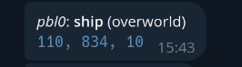

# Paper Telegram Bridge

A fork from [spigot-tg-bridge](https://github.com/kraftwerk28/spigot-tg-bridge) with some new features.

Download from [modrinth](http://modrinth.com/plugin/paper-telegram-bridge), [hangar](https://hangar.papermc.io/pbl0/paper-telegram-bridge)
or from the [releases page](https://github.com/pbl0/paper-telegram-bridge/releases).


### This plugin will send chat messages from Minecraft to Telegram, and from Telegram to Minecraft.

## How to use:

1. Download from [modrinth](http://modrinth.com/plugin/paper-telegram-bridge) and put it in
   `plugins/` directory on your server **OR** clone this repo and run `gradle` inside repo's directory.

2. If you already have telegram bot, skip this step. Otherwise, create it through [BotFather](https://t.me/BotFather).
   You'll go through step-by-step instructions, give a bot **username** and most importantly, obtain a bot **token**.
   Save this token for future use. **Note:** in order to make your bot hear raw text messages (not commands), you must
   disable [privacy mode](https://core.telegram.org/bots#privacy-mode) option which is on by default. Go through bot's
   settings: **Bot Settings -> Group Privacy** and click **Turn Off**.

3. Next, you need to tell plugin about your new bot. You can either:

    - Run Paper server, plugin will log `"No config file found! Saving default one."`. After that, stop server and
      proceed to 4th step.
    -
    Copy [config.yml](https://raw.githubusercontent.com/pbl0/paper-telegram-bridge/master/src/main/resources/config.yml)
    to `plugins/PaperTelegramBridge/` in your server directory.

4. A `config.yml` is just a [valid YAML](https://en.wikipedia.org/wiki/YAML) file, alternative for JSON, but more
   human-readable.
   Now, take bot's **token** which you got in 2nd step and paste them into `config.yml`, so it looks like this:

   ```yaml
   botToken: abcdefghijklmnopq123123123
   # other configuration values...
   ```

5. Run Paper server.

6. Add you bot to chats, where you plan to use it. In each of them, run `/chat_id` command. The bot should respond and
   give special value - **chat id**. Now, open `config.yml` and paste this ID under `chats` section, so it will look
   like this:

   ```yaml
   botToken: abcdefghijklmnopq123123123
   chats: [
       -123456789,
       987654321,
       # other chat id's...
     ]
   ```

7. (Optional) To enable admin commands like `/whitelist`, you need to add Telegram user IDs to the `admins` list in
   `config.yml`.

   ```yaml
   admins: [
       123456789,
       987654321,
       # other admin user ids...
     ]
   ```

8. You can extend `config.yml` with more tweaks, which are described in the table below, but it's not necessary, plugin
   will use default values instead, if they're missing. Also, check out the [example](src/main/resources/config.yml).

9. Re-run server or type `tgbridge_reload` into server's console.

## Plugin configuration:

|        Field         | Description                                                                                      |          Type          |      Required      |                                                        Default                                                        |
|:--------------------:|:-------------------------------------------------------------------------------------------------|:----------------------:|:------------------:|:---------------------------------------------------------------------------------------------------------------------:|
|        enable        | If plugin should be enabled                                                                      |       `boolean`        |        :x:         |                                                        `true`                                                         |
|       botToken       | Telegram bot token ([How to create bot](https://core.telegram.org/bots#3-how-do-i-create-a-bot)) |        `string`        | :heavy_check_mark: |                                                           -                                                           |
|        chats         | Chats, where bot will work (to prevent using bot by unknown chats)                               | `number[] or string[]` | :heavy_check_mark: |                                                         `[]`                                                          |
|        topics        | Telegram forum topics, if left empty it will use the General topic.                              | `number[] or string[]` |        :x:         |                                                         `[]`                                                          |
|        admins        | List of Telegram user IDs authorized to use admin commands like `/whitelist`                     | `number[] or string[]` |        :x:         |                                                         `[]`                                                          |
|  serverStartMessage  | What will be sent to chats when server starts                                                    |        `string`        |        :x:         |                                                  `'Server started.'`                                                  |
|  serverStopMessage   | What will be sent to chats when server stops                                                     |        `string`        |        :x:         |                                                  `'Server stopped.'`                                                  |
|     logJoinLeave     | If true, plugin will send corresponding messages to chats, when player joins or leaves server    |       `boolean`        |        :x:         |                                                        `true`                                                         |
|    logFromMCtoTG     | If true, plugin will send messages from players on server, to Telegram chats                     |       `boolean`        |        :x:         |                                                        `true`                                                         |
|    logFromTGtoMC     | If true, plugin will send messages from chats, to Minecraft server                               |       `boolean`        |        :x:         |                                                        `true`                                                         |
|    logPlayerDeath    | If true, plugin will send message to Telegram if player died                                     |       `boolean`        |        :x:         |                                                        `false`                                                        |
|   logPlayerAsleep    | If true, plugin will send message to Telegram if player fell asleep                              |       `boolean`        |        :x:         |                                                        `false`                                                        |
| logPlayerAdvancement | If true, plugin will send message to Telegram if player gets an advancement                      |       `boolean`        |        :x:         |                                                        `true`                                                         |
|     logInventory     | If true, plugin will send image of inventory, item or ender chest [Read more](#Inventory)        |       `boolean`        |        :x:         |                                                        `true`                                                         |
|   logWhitelistKick   | If true, plugin will send notification when a player is kicked due to not being whitelisted      |       `boolean`        |        :x:         |                                                        `true`                                                         |
|       strings        | Dictionary of tokens - strings for plugin i18n                                                   | `Map<string, string>`  |        :x:         | [See default config](https://github.com/pbl0/paper-telegram-bridge/blob/master/src/main/resources/config.yml#L20-L35) |
|       commands       | Dictionary of command text used in Telegram bot                                                  | `Map<string, string>`  | :heavy_check_mark: |                                                       [See below](#telegram-bot-commands)                                                       |
|    telegramFormat    | Format string for TGtoMC chat message                                                            |        `string`        |        :x:         |   [See default config](https://github.com/pbl0/paper-telegram-bridge/blob/master/src/main/resources/config.yml#L17)   |
|   minecraftFormat    | Format string for MCtoTG chat message                                                            |        `string`        |        :x:         |   [See default config](https://github.com/pbl0/paper-telegram-bridge/blob/master/src/main/resources/config.yml#L16)   |
|    silentMessages    | Disable notification in Telegram chats                                                           |       `boolean`        |        :x:         |                                                         false                                                         |
|      apiOrigin       | Use different API endpoint for the bot                                                           |        `string`        |        :x:         |                                               https://api.telegram.org                                                |
|  disableConfigWatch  | Do not watch the config for changes                                                              |        `string`        |        :x:         |                                                         false                                                         |

## Telegram bot commands:

Commands are customizable through config. If command doesn't exist in config, it will be disabled

|   Command    | Description                                                                            |
|:------------:|:---------------------------------------------------------------------------------------|
|  `/online`   | Get players, currently online                                                          |
|   `/time`    | Get [time](https://minecraft.wiki/w/Daylight_cycle) on server                          |
|  `/chat_id`  | Get current chat ID (in which command was run) for config.yml                          |
| `/whitelist` | (Admin only) Manage server whitelist - list whitelisted players or add/remove a player |

## Format string:

```
+--------+ >--minecraftMessageFormat(message)-> +--------------+
| Paper |                                      | Telegram bot |
+--------+ <--telegramMessageFormat(message)--< +--------------+
```

Applies to `telegramMessageFormat` and `minecraftMessageFormat` configurations.
Must contain `%username%` and `%message%` inside.
You can customize message color with it (coloring works only for `telegramMessageFormat`). You can customize
bold/italics/strikethrough formatting (works only for `minecraftMessageFormat`).
See [Minecraft message color codes](https://www.digminecraft.com/lists/color_list_pc.php)
and [Telegram message formatting](https://core.telegram.org/bots/api#html-style) for more information.
This feature is related to [this issue](https://github.com/kraftwerk28/spigot-tg-bridge/issues/6)

## Plugin commands:

|      Command      | Description                                                                                                       |
|:-----------------:|:------------------------------------------------------------------------------------------------------------------|
| `tgbridge_reload` | Reload plugin configuration w/o need to stop the server. Works only through server console                        |
|   `tgbroadcast`   | Broadcast a message to all Minecraft players and configured Telegram chats; usable by players and command blocks. |

## Permissions

|         Permission          | Description                                                                                                                           |
|:---------------------------:|:--------------------------------------------------------------------------------------------------------------------------------------|
| `tg-bridge.silentjoinleave` | When set to **true** the bot won't send join and leave messages for that player. It will also be hidden from the **/online** command. |

## Inventory

Similar behavior as InteractiveChat plugin (not a dependency!).
Commands implemented:

- [inv]
- [item]
- [ender]


## Whitelist Management

Server admins can manage the whitelist directly from Telegram using the `/whitelist` command:

- `/whitelist` - List all whitelisted players
- `/whitelist <player_name>` - Toggle whitelist status for a player (add if not whitelisted, remove if already
  whitelisted)

This command is only available to users listed in the `admins` configuration field. The plugin will also send
notifications when players try to join but are kicked due to not being whitelisted (configurable via
`logWhitelistKick`).


## Xaero's Map waypoint sharing

When a player shares a waypoint from Xaero's Map mods, the plugin will send a formatted message with the waypoint
details, including the waypoint name, world, and coordinates.



The message is customizable in the configuration file. Example:

```yaml
strings:
  waypoint: "<i>%username%</i>: <b>%waypointName%</b> (%world%)\n<code>%x%, %y%, %z%</code>"
```

Accepted values: %username%, %waypointName%, %world%, %x%, %y%, %z% and %raw% (for debugging purposes).

## Minecraft assets (development-only)

This repository won't include the Minecraft icons required to build the plugin for the inventory and advancements
rendering features.
This icons can be generated using the mod [IconExporter](https://github.com/CyclopsMC/IconExporter) and running in-game
this command:

```
/iconexporter export 64
```

Some icons, like potions, require renaming. The resulting .png files need to be placed `src/main/resources/textures`.
